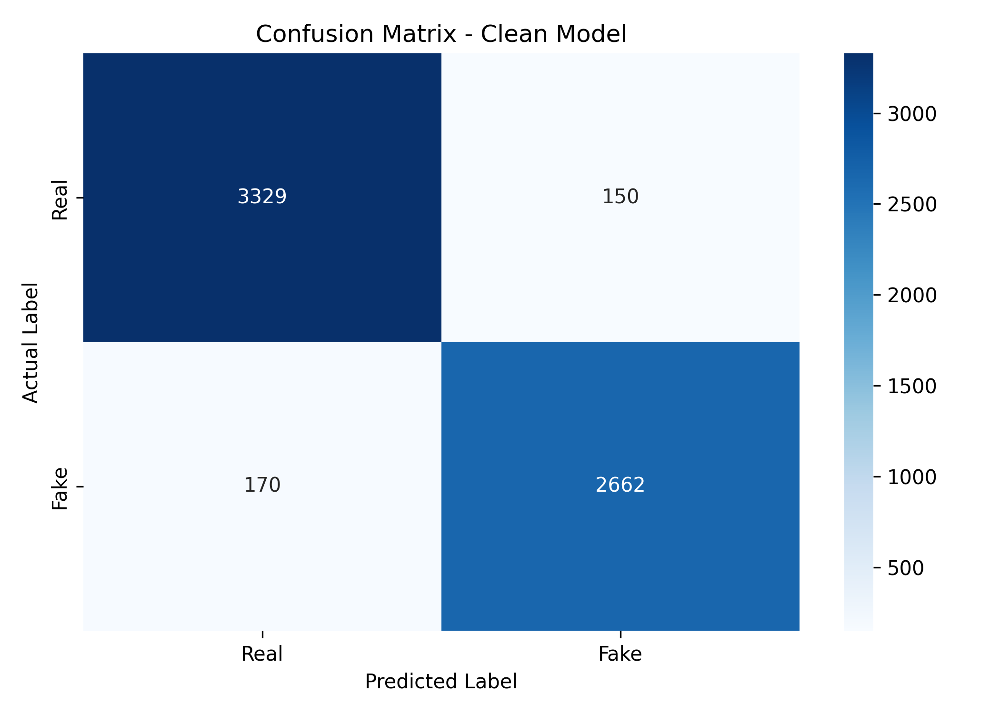
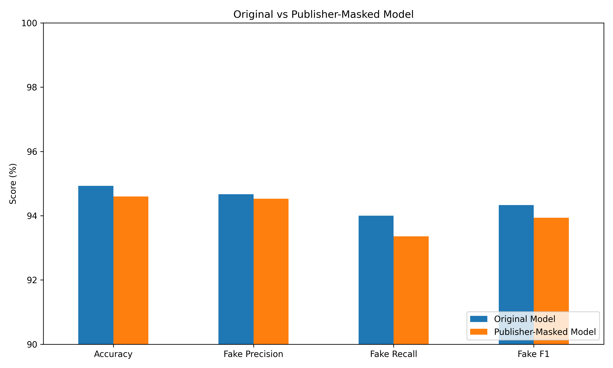

# Fake News Detection using Machine Learning

A machine learning-based Fake News Detection system using **TF-IDF Vectorization and Logistic Regression** to classify news articles as Real or Fake.

This repository contains the ML pipeline, trained model, prediction utility, experimental analysis, and evaluation reports.

## Project Overview

The objective of this project is to develop a text classification model that identifies patterns associated with real and fake news articles.

The model learns textual patterns from labelled news articles and predicts whether an input article belongs to the Real or Fake class.

**Note:** This is a machine learning classification system, not an independent fact-checking engine.

## Tech Stack

- Python
- Pandas
- Scikit-learn
- TF-IDF Vectorization
- Logistic Regression
- Matplotlib
- Seaborn
- Joblib

## Dataset

The project uses the WELFake dataset.

Dataset statistics after preprocessing:

| Description | Count |
|---|---:|
| Original records | 72,134 |
| Cleaned records | 63,108 |
| Training samples | 50,486 |
| Validation samples | 6,311 |
| Testing samples | 6,311 |

### Preprocessing

The following preprocessing operations were performed:

- Removed unnecessary columns.
- Handled missing article titles and text.
- Removed empty article content.
- Combined article titles and text into a single content field.
- Removed duplicate articles.
- Performed stratified train-validation-test splitting (80:10:10).
- Verified that no exact article content overlapped between splits.

The dataset itself is not included in this repository.

## Model Architecture

The final model uses a Scikit-learn Pipeline with two components.

### 1. TF-IDF Vectorization

TF-IDF converts news article text into numerical feature vectors.

Configuration:

| Parameter | Value |
|---|---|
| max_features | 30,000 |
| ngram_range | (1, 2) |
| stop_words | English |
| min_df | 2 |
| sublinear_tf | True |

### 2. Logistic Regression

Logistic Regression performs binary classification using the TF-IDF features.

Configuration:

- max_iter = 1000
- random_state = 42

## Model Performance

The final model was evaluated on a held-out test set of 6,311 articles.

| Metric | Real | Fake |
|---|---:|---:|
| Precision | 95.14% | 94.67% |
| Recall | 95.69% | 94.00% |
| F1-score | 95.41% | 94.33% |

**Overall Test Accuracy: 94.93%**

### Confusion Matrix



| Actual / Predicted | Real | Fake |
|---|---:|---:|
| Real | 3,329 | 150 |
| Fake | 170 | 2,662 |

## Experimental Analysis

### Publisher-Ablation Experiment

An additional experiment was conducted to investigate the influence of explicit publisher names on model predictions.

Publisher names were masked in both training and testing text before training a separate model.

| Metric | Original Model | Publisher-Masked Model |
|---|---:|---:|
| Accuracy | 94.93% | 94.60% |
| Fake Precision | 94.67% | 94.53% |
| Fake Recall | 94.00% | 93.36% |
| Fake F1-score | 94.33% | 93.94% |

The relatively small performance difference suggests that explicit publisher names alone do not explain most of the model's predictive performance.

However, other dataset-specific patterns, writing styles, and vocabulary associations may still influence predictions.

### Model Comparison



## Repository Structure

```text
Fake-News-Detection-ML/
│
├── model/
│   ├── fake_news_model_clean.pkl
│   ├── predict.py
│   ├── train.py
│   └── train_clean.py
│
├── reports/
│   ├── figures/
│   │   ├── confusion_matrix.png
│   │   └── model_comparison.png
│   ├── classification_report.csv
│   ├── model_comparison.csv
│   └── evaluation.py
│
├── requirements.txt
├── README.md
└── .gitignore
```

## Installation and Setup

### 1. Clone the repository

```bash
git clone YOUR_REPOSITORY_URL
cd Fake-News-Detection-ML
```

### 2. Install dependencies

```bash
pip install -r requirements.txt
```

### 3. Load the trained model

```python
import joblib

model = joblib.load("model/fake_news_model_clean.pkl")
```

### 4. Generate predictions

```python
from model.predict import predict_news

article = "Enter your news article here."

result = predict_news(article)

print(result)
```

The prediction function returns:

- `prediction`: Real or Fake
- `score`: Estimated model probability for the predicted class, expressed as a percentage.

The model expects combined article title and text as input.

## Label Mapping

- 0 = Real News
- 1 = Fake News

## Limitations

- The model learns patterns from the WELFake dataset and does not independently verify factual claims.
- Dataset bias and possible label noise can affect predictions.
- Publisher and writing-style associations may influence classification.
- Performance on completely unseen datasets may differ from the reported test results.
- A high prediction score does not guarantee factual correctness.

## Future Improvements

- Evaluate generalisation on independent news datasets.
- Explore Transformer-based text classification models.
- Investigate publisher-disjoint evaluation.
- Incorporate external evidence retrieval and claim verification.
- Improve robustness against misleading headlines and adversarial text.

## Acknowledgements

Dataset: WELFake — a labelled fake and real news dataset.

